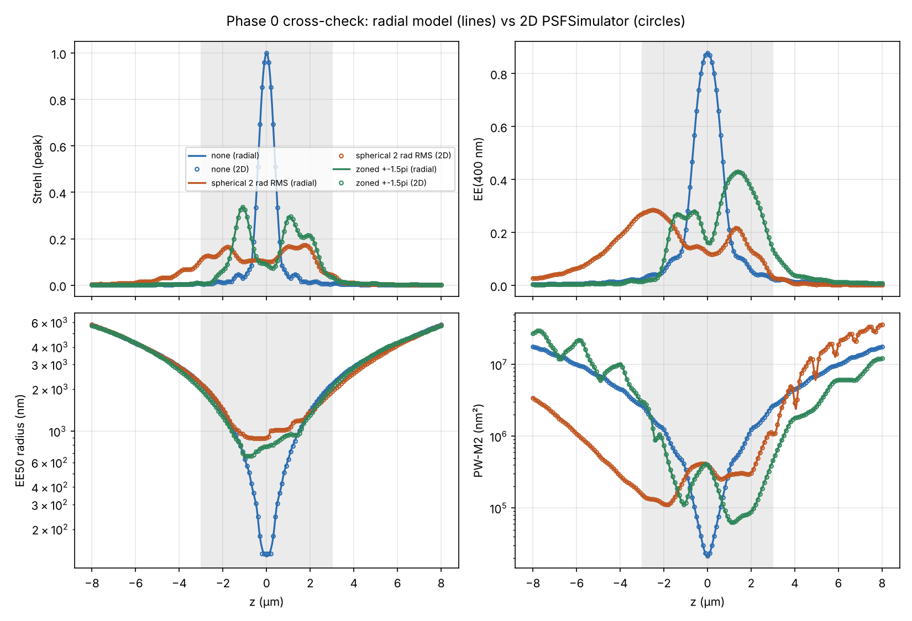
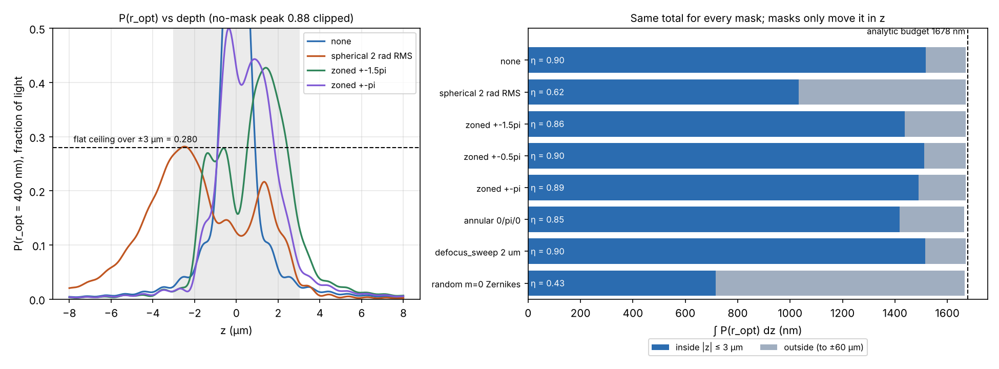

# Phase 0: fast evaluator and budget check

System: NA 1.1, 525 nm, n = 1.33, r_opt = 400 nm, EE denominator = 10 um disk,
uniform pupil apodization, continuous phase (no SLM pixelation or
quantisation). Reproduce with `python scripts/phase0_check.py`; the raw output
is in `phase0/phase0_output.md`, the numbers in `phase0/results.json`.

## Gate: the radial model matches the 2D model. PASSED

`psfsim/radial.py` evaluates the 1D Debye (Hankel) integral over the pupil,
with the same `pupil_amplitude` and exact `defocus_phase` as `PSFSimulator`.
It was compared with the 2D FFT model at 161 depths (-8 to +8 um, 100 nm steps)
for the three reference masks.

Largest difference, as a fraction of the curve's maximum (all z / |z| <= 3 um):

| mask | Strehl (peak) | EE(400) | P(r_opt) | EE50 | PW-M2 |
|---|---|---|---|---|---|
| none | 0.08 % / 0.08 % | 0.16 % / 0.16 % | 0.15 % / 0.15 % | 0.19 % / 0.51 % | 0.17 % / 0.14 % |
| spherical 2 rad RMS | 0.46 % / 0.46 % | 0.48 % / 0.48 % | 0.48 % / 0.48 % | 0.19 % / 0.49 % | 1.65 % / 1.40 % |
| zoned ±1.5π | 0.35 % / 0.35 % | 0.45 % / 0.45 % | 0.44 % / 0.44 % | 0.30 % / 0.84 % | 0.77 % / 1.45 % |

All are inside the 1–2 % target. The remaining differences come from the 2D
side: its pupil edge is pixelated on a 128 px radius and its image grid is
60 nm (EE50 is snapped to pixel-centre radii). The radial model is converged
to better than 1e-3 (tested against 4x pupil nodes and half the radial step).

Speed: a 321-plane sweep with every metric takes ~0.3 s, versus ~75 s in 2D.
On-axis Strehl alone takes ~20 ms, which is cheap enough for the optimizer's
inner loop in Phase 1 and 2.

## Budget check: the z-integrals do not depend on the mask. CONFIRMED

Parseval in c = cos θ at a fixed radius r gives, for any radially symmetric
phase,

- ∫ S_axial dz = (λ/n) · 2(n/NA)² ∫A²c du / (∫A du)²
- ∫ I(r, z) dz = 2π (n/λ) ∫A²c J0²(2πNAρr/λ) du / ∫A² du, with u = ρ². Integrating this over the r_opt disk gives ∫P(r_opt) dz.

No phase appears in either formula. `RadialPSF.budgets()` evaluates both.

| quantity | analytic (infinite z) | numeric, 8 masks, ±60 um | numeric, ±8 um |
|---|---|---|---|
| ∫ S_axial dz | **925 nm** | 923.6 nm for all masks (919 annular, 923.2 random) | 743–914 nm |
| ∫ P(r_opt) dz | **1678 nm** | 1669.8 nm for all masks (1665 annular, 1667 random) | 918–1617 nm |

- Over the same window, the eight masks agree to better than 1e-4. The tests extend this to ±400 um for the axial Strehl, where all five tested masks are within 0.2 % of the analytic value.
- The gap to the analytic value is light still in the tails. The tails decay slowly for masks with sharp phase edges (annular 0/π) or strong phase (random m=0 Zernikes).
- The 2D model gives the same within-window integrals: 914.9 / 909.8 / 914.1 nm for S_axial and 1616 / 1585 / 1613 nm for P(r_opt), for none / spherical / zoned. The radial model gives 914.1 / 909.0 / 913.2 and 1617 / 1586 / 1614.
- The paraxial estimate 2nλ/NA² = 1154 nm is 25 % too high at NA/n = 0.83. The "uniform g" estimate λ/(n(1−c0)) = 901 nm is close but not exact, because a flat pupil amplitude gives g(c) ∝ c, not a flat g.

Two of the metrics are **not** invariant. Neither should be treated as a budget:

- **Peak Strehl** (what `PSFResult.strehl` reports): the peak can sit on a ring away from the axis. Over ±8 um its integral is 891–951 nm.
- **EE = P(r_opt) / P(10 um)**: at large |z| some light falls outside the 10 um disk, which inflates the ratio. The random-Zernike mask gives ∫EE dz = 937 nm, against ~1625 nm for the others.

## What this means for the target

- If the whole budget sat flat inside ±3 um, P(r_opt) would be **0.28** of the light. Over ±4 um it would be **0.21**. EE ≈ P(r_opt) here, because within ±3 um more than 98 % of the light is inside 10 um. These ceilings are a little higher than the 0.2 / 0.15 estimated in the plan, because the actual budget is 1.68 um.
- Every current mask spends most of the budget inside ±3 um (η = 0.86–0.90), except the 2 rad spherical mask (η = 0.62, the rest below −3 um). None of them spends it flat: the EE floor over ±3 um is 0.014–0.031 for every mask, set by the range edges. Phase 1 and 2 should therefore optimise the minimum, not the mean. The mean over ±3 um is already 0.24–0.25 for most masks, close to the 0.28 ceiling.

In-range summary, |z| ≤ 3 um (radial model):

| mask | S(0) | EE(0) | η (vs budget) | EE min | EE mean | min/mean |
|---|---|---|---|---|---|---|
| none | 1.000 | 0.877 | 0.90 | 0.024 | 0.252 | 0.09 |
| spherical 2 rad RMS | 0.101 | 0.124 | 0.62 | 0.031 | 0.173 | 0.18 |
| zoned ±0.5π | 0.811 | 0.738 | 0.90 | 0.017 | 0.251 | 0.07 |
| zoned ±π | 0.405 | 0.429 | 0.89 | 0.014 | 0.248 | 0.06 |
| zoned ±1.5π | 0.090 | 0.161 | 0.86 | 0.014 | 0.239 | 0.06 |
| annular 0/π/0 | 0.181 | 0.401 | 0.85 | 0.029 | 0.244 | 0.12 |
| defocus_sweep 2 um | 0.284 | 0.610 | 0.90 | 0.027 | 0.252 | 0.11 |

η here is ∫_{−3}^{3} P(r_opt) dz divided by the analytic budget. The script
also reports η of EE against the ±8 um window, as defined in the plan.

## Caveats and decisions to confirm

1. **Five modules were missing from the upload and were rebuilt**: `config`, `pupil`, `zernike`, `slm` and `detector`. The radial model reuses `pupil_amplitude` and `defocus_phase`, so if the lab versions differ, swap them in and re-run the script.
2. **Pupil apodization.** The default is **uniform**, because it reproduces the existing tracking-metrics figure: EE400(0) = 0.877 with no mask, S(0) = 0.81 / 0.41 / 0.09 for zoned ±0.5π / ±π / ±1.5π, and the spherical plateau sits on the −z side. The physically expected detection apodization for an isotropic emitter is 1/√cosθ (`apodization="emission"`). It lowers the budget:

   | apodization | ∫S_ax dz | ∫P(r_opt) dz | EE400(0) | flat ceiling ±3 um |
   |---|---|---|---|---|
   | uniform | 925 nm | 1678 nm | 0.877 | 0.280 |
   | emission 1/√cosθ | 907 nm | 1515 nm | 0.845 | 0.253 |

   The mask ranking is unlikely to change. The absolute ceiling does change, by about 10 %.
3. The cross-check uses continuous phase. The 8-bit, pixelated SLM model belongs to Phase 4.
4. Sign convention: defocus phase = +(z/λ) n (cosθ − 1). A ring at c focuses at z = −φ'(c)/(kn), which matches the focus map in the plan.

## Ready for Phase 1

- `RadialPSF.simulate(z, mask, params)` returns every per-plane metric. `phase_waves=` takes free-form phases.
- `RadialPSF.axial_strehl` is the cheap path for an optimizer's inner loop.
- `psfsim.metrics.range_summary` gives η, min, mean, flatness and the ceiling.
- Suggested first Phase 1 step: re-centre the 2 rad spherical mask with a defocus offset. Its 38 % of the budget below −3 um is the easiest gain available.
