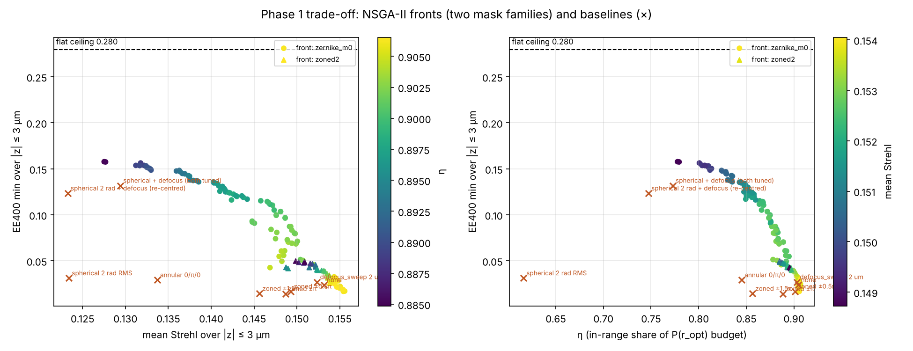
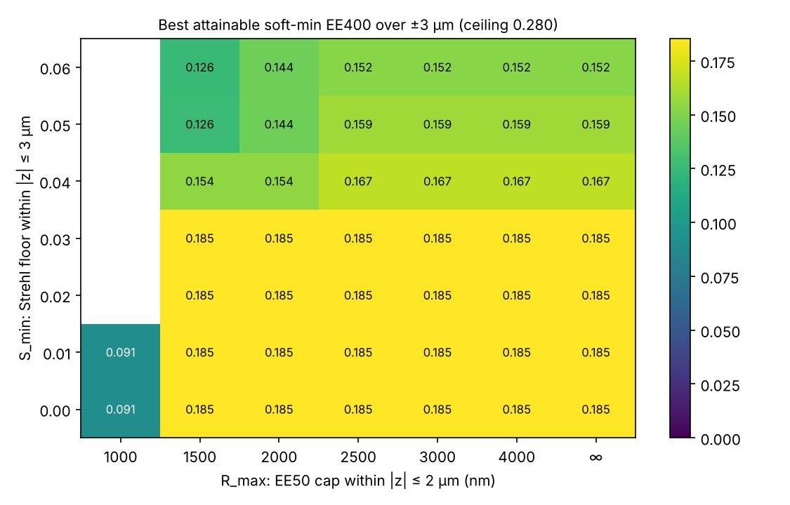
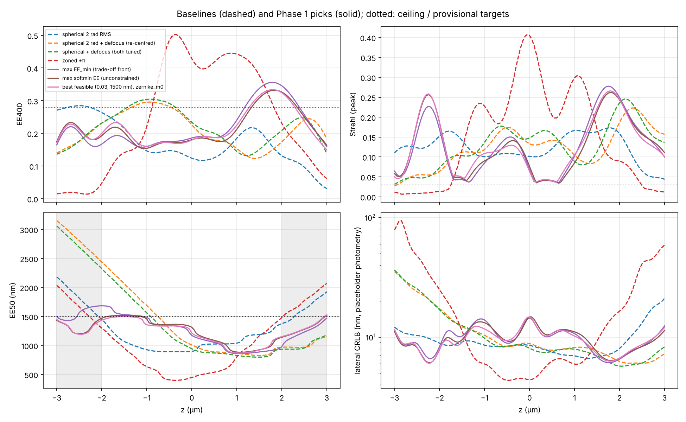

# Phase 1: objective and targets

Same system as Phase 0: NA 1.1, 525 nm, n = 1.33, r_opt = 400 nm, uniform
apodization, radial model. Reproduce with `python scripts/phase1_pareto.py`
(~12 min). The raw output is in `phase1/phase1_output.md`, the numbers in
`phase1/results.json`, and all 35,124 evaluations (parameters plus every
metric) in `phase1/evals.csv`.

## The objective (implemented in `psfsim/objective.py`)

```
maximise    softmin_{|z| ≤ 3 µm} EE400(z)
subject to  S(z)    ≥ S_min   for |z| ≤ 3 µm    (peak Strehl, detection proxy)
            EE50(z) ≤ R_max   for |z| ≤ 2 µm
```

- **Soft minimum.** This is the power mean (mean EE^p)^(1/p) with p = −10. It has no temperature parameter in EE units, it sits between the minimum and the harmonic mean, and it is smooth, which helps CMA-ES and gradient methods in Phase 2–3. On the masks studied it is 15–25 % above the hard minimum, and the two rank masks the same way.
- **What each evaluation returns.** `Evaluator.evaluate(phase)` returns:
  - the soft-min, the minimum and the mean of EE400;
  - η (the share of the fixed P(r_opt) budget that falls inside ±3 µm), flatness (min/mean) and the coefficient of variation;
  - the minimum and mean Strehl, the largest EE50 within ±2 µm, and the mean PW-M2;
  - a feasibility flag and a penalised score, for single-objective optimizers;
  - optionally, the worst-case lateral CRLB (`with_crlb=True`).
- **Cost.** About 10 ms per mask for 121 planes; about 0.1 s more with the CRLB.

## Alternative objective: lateral CRLB (`psfsim/crlb.py`)

- **What it computes.** The Fisher information of the camera-sampled PSF: 108 nm pixels, a 21 × 21 px ROI, Poisson noise plus background, and sCMOS read noise. For an emitter at a pixel centre, the cross terms with y, z, N and b vanish by symmetry, so the result is the exact lateral bound.
- **Validation.** It agrees within 1 % with a brute-force calculation that shifts the 2D `PSFSimulator` PSF and bins it into camera pixels (this is a test in `tests/test_objective.py`).
- **Photometry is a placeholder.** It uses 2000 photons, 10 photons/px background and 1.6 e⁻ read noise. These are not ReflEx3D numbers (this is still an open question in the plan), so treat absolute CRLB values as illustrative.
- **Agreement with EE.** Across the 114 points of the trade-off front, soft-min EE400 and worst-case CRLB rank masks almost the same way (Spearman 0.98). So, for this mask class and photometry, the EE objective doesn't conflict with the main criterion from the literature. This should be re-checked with real photometry, especially at high background.

## Pareto study (NSGA-II, 100 × 80, two families)

- **Family A, `zernike_m0`.** Noll-normalised Z4, Z11, Z22 and Z37. It contains the spherical baselines and the re-centred spherical.
- **Family B, `zoned2`.** The current `zoned_zernike` mask: two zones, a free edge, plain defocus per zone and a piston on the outer zone. It contains all the zoned baselines.

### Study 1: the trade-off asked for in the plan (EE_min vs mean Strehl vs η)



- **The three objectives conflict along one curve.** Raising the EE floor from ~0.02 (no mask) to 0.158 costs mean Strehl (0.155 → 0.128) and η (0.90 → 0.78). The flat-budget ceiling of 0.28 is never approached: the best floor is 56 % of it.
- **Family B is dominated.** Two zones with paraxial defocus can't produce a flat profile, even with a free piston: its best soft-min is 0.162, with EE50 up to 3.3 µm. This is the case for the Phase 2 re-parameterisation (exact defocus per zone, more zones).
- **Every current mask lies far below the front.** The re-centred spherical gets close, but it fails the EE50 constraint (2.4 µm at z = −2 µm).

### Study 2: picking the thresholds (soft-min EE vs Strehl_min vs EE50_max)

The front of this study gives the best attainable EE floor directly for any
pair (S_min, R_max):



- **R_max ≤ 1000 nm within ±2 µm can't be met by any useful mask, including no mask.** No mask already has EE50 = 1.4 µm at z = ±2 µm, because of the geometric defocus cone. And because EE400 can't exceed ~0.28, more than half the light always lies outside 400 nm, so EE50 measures the halo rather than the core. Together, R_max = 1000 nm and S_min = 0.05 had no feasible mask at all.
- **The knee is at S_min ≈ 0.03 and R_max ≈ 1500 nm.** Below it, neither constraint binds (soft-min stays at 0.185). Above it, both start to cost: S_min = 0.04 gives 0.154–0.167, and S_min = 0.05 with R_max = 1500 nm gives 0.126.

### Baselines and best masks (|z| ≤ 3 µm, provisional targets S_min 0.03, R_max 1500 nm)

| mask | soft-min EE | EE min | EE mean | η | min/mean | S min | S mean | EE50 max ±2 µm | worst CRLB* | feasible |
|---|---|---|---|---|---|---|---|---|---|---|
| none | 0.034 | 0.024 | 0.252 | 0.90 | 0.09 | 0.005 | 0.153 | 1405 | 137 nm | no |
| spherical 2 rad RMS (bench) | 0.049 | 0.031 | 0.173 | 0.62 | 0.18 | 0.044 | 0.123 | 1450 | 21 nm | yes |
| zoned ±π | 0.019 | 0.014 | 0.248 | 0.89 | 0.06 | 0.007 | 0.149 | 1482 | 94 nm | no |
| zoned ±1.5π | 0.021 | 0.014 | 0.239 | 0.86 | 0.06 | 0.007 | 0.146 | 1311 | 55 nm | no |
| annular 0/π/0 | 0.042 | 0.029 | 0.244 | 0.85 | 0.12 | 0.009 | 0.134 | 911 | 29 nm | no |
| spherical 2 rad + defocus (re-centred) | 0.157 | 0.123 | 0.210 | 0.75 | 0.59 | 0.028 | 0.123 | 2438 | 35 nm | no |
| spherical + defocus, both tuned | 0.164 | 0.132 | 0.217 | 0.77 | 0.61 | 0.031 | 0.129 | 2326 | 36 nm | no |
| **best feasible (family A)** | **0.185** | **0.149** | 0.217 | 0.77 | 0.69 | 0.036 | 0.129 | 1498 | 15 nm | yes |
| highest EE_min (trade-off front) | 0.182 | 0.158 | 0.219 | 0.78 | 0.72 | 0.036 | 0.128 | 1685 | 14 nm | no |

\* Placeholder photometry.

- **Best feasible mask.** Z4 = +0.032, Z11 = −0.318, Z22 = −0.125, Z37 = +0.085 waves RMS. That is about 2 rad RMS of spherical with the opposite sign to the bench mask, plus some higher-order spherical and almost no defocus.
- **Compared with the bench mask.** It raises the EE floor over ±3 µm from 0.031 to 0.149 (4.8×). It also improves the worst-case CRLB from 21 to 15 nm, at the same Strehl floor.
- **Room left.** Its EE profile still has a lobe of 0.33 at z ≈ +1.8 µm (see the figure below). That lobe is budget that Phase 2–3 could spread into the dips.



The dotted lines in this figure come from the first run, which used S_min = 0.05 and R_max = 1000 nm.

## Gate: thresholds to agree with your advisor

Proposed defaults, now in `Targets`, marked PROVISIONAL:

| setting | proposed | rationale |
|---|---|---|
| depth range | ±3 µm | plan; ±4 µm revisited after Phase 2 |
| r_opt | 400 nm | unchanged |
| soft-min exponent p | −10 | close to the minimum, smooth |
| S_min, within ±3 µm | **0.03** | just below the knee; S_min = 0.04 costs ~15 % of the floor |
| R_max, EE50 within ±2 µm | **1500 nm** | ≈ the no-mask EE50 at ±2 µm, i.e. "no worse than the defocus cone"; 1000 nm can't be met |
| target EE floor | ≥ 0.15 | 0.149 already reached in family A; ceiling 0.28 |

Questions for the advisor:
1. Are S_min = 0.03 and R_max = 1500 nm acceptable? The alternative is to drop EE50 as a constraint and keep it as a reported metric only: EE50 is dominated by the halo, and CRLB already penalises spread-out light.
2. Is an EE400 floor of ~0.15–0.19 over ±3 µm acceptable, or should r_opt grow? This is the remaining open question from the plan.
3. Photon count, background and pixel size from real ReflEx3D frames, so the CRLB can be used quantitatively.

## Notes for Phase 2

- `Evaluator.evaluate(phase)` and `evaluate_mask(...)` are ready to serve as the CMA-ES and Bayesian-optimisation objective, using the `score` field or the constraints explicitly.
- The bar to beat is the best feasible mask from family A: soft-min 0.185. Re-centred spherical scores 0.157 but is infeasible.
- The 2-zone family as it is now can't compete, which supports introducing `zoned_focus` (exact per-zone defocus, pistons, N = 2–5).
