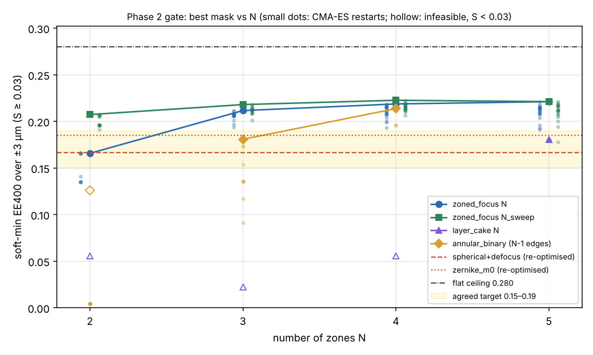
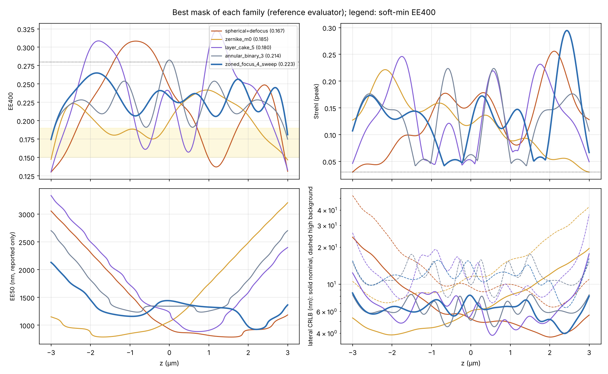
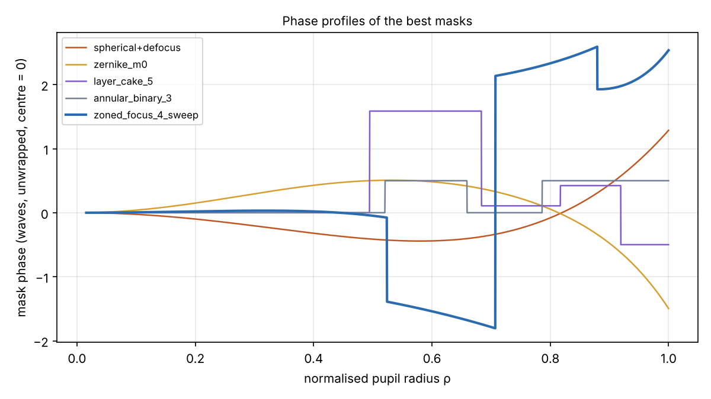

# Phase 2: zoned family, re-parameterised

**Objective:** soft-min of EE400 over |z| ≤ 3 µm, subject to peak Strehl ≥ 0.03.
EE50 is reported only. The target floor is 0.15–0.19 and the flat-budget ceiling
is 0.280.

**Photometry for the CRLB:** 98.5 nm pixels, about 3,000 photons, 4.6 photons/px
background, 1.6 e⁻ read noise. The high-background case uses 50 photons/px; see
`psfsim/crlb.py` for how these were derived from your frames.

**Reproduce:** `python scripts/phase2_zoned.py`. It takes about 32 min on 4 cores
and makes 645,335 evaluations.

**Outputs, in `phase2/`:**
- `results.json`: per-configuration results;
- `references.json`: the bench and no-mask references;
- `slm_indicators.json`;
- `best_curves.npz`: the z-curves of every best mask;
- `evals_top2000_per_family.csv.gz`: the top 2,000 evaluations per family. The full 645k-row log is written to `phase2/evals.csv.gz` by the script, but it is 56 MB and is not committed.

## The new mask: `zoned_focus`

Zone k (ρ_{k−1} ≤ ρ < ρ_k) carries

  φ_k(c) = −(n/λ)·[ z_k (c − 1) + (s_k / 2Δc_k)(c − c̄_k)² ] + p_k,  with c = cos θ.

- **z_k (exact defocus):** each zone focuses at its own depth z_k with exact defocus, not Zernike 2ρ²−1. A one-zone mask refocuses with Strehl exactly 1.
- **p_k (piston):** a free piston per zone. SLM zones are mutually coherent, so the pistons control how neighbouring foci interfere.
- **s_k (sweep):** an optional sweep spreads zone k's focus over z_k ± s_k/2.
- **Search parameters:** the edges are parameterised as widths in t = (1 − c)/(1 − c₀) (equal t = equal depth of focus).
- **Test:** the radial model matches the 2D model for this mask to within 2% (`tests/test_zoned_focus.py`).

## Results (best mask of each configuration, reference evaluator: 2048 rings, dz 12.5 nm)

| configuration | params | soft-min EE | EE min | EE mean | η | min/mean | S min | EE50 max ±2 µm | worst CRLB nominal / high bg | feasible |
|---|---|---|---|---|---|---|---|---|---|---|
| no mask | 0 | 0.035 | 0.024 | 0.254 | 0.90 | 0.09 | 0.005 | 1405 | 83 / 208 nm | no |
| spherical 2 rad RMS (bench) | 0 | 0.051 | 0.031 | 0.174 | 0.62 | 0.18 | 0.044 | 1450 | 12.8 / 29.1 nm | yes |
| zoned ±1.5π (current) | 0 | 0.022 | 0.014 | 0.240 | 0.86 | 0.06 | 0.007 | 1311 | 35.3 / 88.5 nm | no |
| spherical + defocus (re-centred) | 2 | 0.167 | 0.130 | 0.221 | 0.78 | 0.59 | 0.030 | 2311 | 24.1 / 52.5 nm | yes |
| Z4/Z11/Z22/Z37 (Phase 1 family) | 4 | 0.185 | 0.147 | 0.201 | 0.71 | 0.73 | 0.030 | 2484 | 19.5 / 42.6 nm | yes |
| zoned_zernike, 2 zones (current family) | 4 | 0.164 | 0.125 | 0.227 | 0.80 | 0.55 | 0.030⁻ | 3316 | 20.8 / 44.9 nm | no (just) |
| layer cake N = 5 (equal dc, pistons) | 4 | 0.180 | 0.130 | 0.233 | 0.80 | 0.56 | 0.043 | 2500 | 17.7 / 36.7 nm | yes |
| binary 0/π annular, 2 edges | 3 | 0.181 | 0.135 | 0.218 | 0.76 | 0.62 | 0.060 | 2008 | 13.7 / 27.2 nm | yes |
| **binary 0/π annular, 3 edges** | **4** | **0.214** | **0.175** | 0.224 | 0.77 | 0.78 | 0.042 | 1814 | **8.3 / 17.5 nm** | yes |
| zoned_focus N = 2 | 5 | 0.166 | 0.127 | 0.228 | 0.81 | 0.56 | 0.033 | 3232 | 20.0 / 42.7 nm | yes |
| zoned_focus N = 2 + sweep | 7 | 0.207 | 0.163 | 0.218 | 0.76 | 0.75 | 0.041 | 2711 | 12.7 / 25.1 nm | yes |
| zoned_focus N = 3 | 8 | 0.212 | 0.174 | 0.222 | 0.78 | 0.78 | 0.038 | 1683 | 10.7 / 19.9 nm | yes |
| zoned_focus N = 3 + sweep | 11 | 0.218 | 0.174 | 0.224 | 0.78 | 0.78 | 0.046 | 1655 | 11.7 / 22.1 nm | yes |
| zoned_focus N = 4 | 11 | 0.219 | 0.181 | 0.223 | 0.78 | 0.81 | 0.038 | 1722 | 10.1 / 20.6 nm | yes |
| **zoned_focus N = 4 + sweep** | **15** | **0.223** | 0.174 | 0.231 | 0.80 | 0.76 | 0.042 | 1456 | **8.5 / 16.3 nm** | yes |
| zoned_focus N = 5 | 14 | 0.221 | 0.177 | 0.225 | 0.77 | 0.79 | 0.038 | 1850 | 10.2 / 21.7 nm | yes |
| zoned_focus N = 5 + sweep | 19 | 0.221 | 0.174 | 0.233 | 0.76 | 0.75 | 0.031 | 2291 | 11.5 / 24.8 nm | yes |

The layer cake with N = 2–4 and the binary mask with 1 edge cannot reach S ≥ 0.03; see `phase2/results.json`.

## Gate: PASSED

1. **The best zoned mask beats the re-centred spherical.**
   - Soft-min EE400 is 0.223 against 0.167 (+34%), and the EE floor is 0.174 against 0.130.
   - It also beats the best Phase 1 family (Z4–Z37, 0.185) by 21%.
   - Against the bench 2 rad spherical mask, the EE floor rises from 0.031 to 0.174 (5.6×) and the worst-case CRLB improves from 12.8 nm to 8.5 nm.
2. **Adding zones stops helping at N ≈ 3–4.**
   - Without sweep: N = 2 → 3 gains +0.046, N = 3 → 4 gains +0.007, and N = 4 → 5 gains +0.002.
   - With sweep: N = 2 → 3 gains +0.011, N = 3 → 4 gains +0.005, and N = 4 → 5 changes by −0.002.
   - The sweep term matters mostly for N = 2 (+0.041). Beyond that it adds ≤ 0.006.
3. **Against the targets:** every N ≥ 3 zoned mask, and the 3-edge binary mask, have an EE floor (hard minimum) of 0.17–0.18, inside the agreed 0.15–0.19 band. Their soft-min is 0.21–0.22. The best soft-min is 80% of the flat ceiling. η is about 0.8 and the EE profile ripples between 0.17 and 0.26 (min/mean 0.76), so most of what remains is interference ripple between foci.

## Findings beyond the gate

- **A binary 0/π mask with 3 edges comes within 4% of the best zoned mask** (soft-min 0.214), and it ties for the best worst-case CRLB in the nominal regime (8.3 nm).
  - It has only 4 parameters, and 80% of the CMA-ES restarts land within 1% of its optimum, so the optimisation is well behaved.
  - It needs exactly two SLM grey levels (0.5 wave is level 128 at 8 bits) and has no phase slope.
  - Edges: ρ = 0.521, 0.659, 0.786. Phases: 0, π, 0, π from the centre out.
  - It is the binary-annular design studied by Lévêque et al., now optimised for this NA and depth range.
- **EE400 and the CRLB do not rank masks the same way across families.** The re-centred spherical and the Z4–Z37 masks have a better EE floor than the bench mask but a worse worst-case CRLB (24 and 19.5 nm against 12.8 nm), because their spot at +3 µm is spread out. The two leading candidates (zoned_focus N = 4 + sweep and binary 3-edge) are best on both metrics, so the choice between them doesn't depend on which criterion you prefer.
- **The ranking is unchanged in the high-background regime** (50 photons/px). All CRLBs roughly double, and the two leading candidates are still best (16.3 and 17.5 nm).
- **EE50, reported only:** within ±2 µm the best zoned mask reaches 1.46 µm, about the no-mask value (1.41 µm). The spherical, Z4–Z37 and layer-cake masks reach 2.3–2.5 µm.

## Search reliability

- **Different methods agree.**
  - For N = 2 without sweep: the dense grid (114,376 points) reached 0.162, CMA-ES 0.165, and Optuna TPE 0.164.
  - For N = 2 with sweep, polishing the grid optimum gave the same 0.207 that several CMA-ES restarts found independently.
  - For N = 3, Optuna TPE (2,000 trials) reached 0.196 without sweep and 0.210 with it, against CMA-ES's 0.212 and 0.218.
  - So the CMA-ES results are not an artefact of one method.
- **Optuna is the stand-in for Bayesian optimisation.** I used TPE, a sequential model-based optimiser, not a Gaussian-process method. A GP method needs PyTorch, which isn't installed here.
- **The landscape is rugged for N ≥ 3.** Only 5–10% of the 20 CMA-ES restarts land within 1% of the best (see the dots in the gate figure). The N = 4–5 optima may be slightly under-explored. That doesn't change the conclusion: the plateau is clear and sits well below the ceiling.
- **One sweep parameter is at its bound.** For zoned_focus N = 4 + sweep, the outer zone's sweep is at the −4 µm limit. Widening the bound could add a little.

## SLM indicators (assumed 600 SLM pixels across the pupil; to be replaced with the real number in Phase 4)

| mask | phase jumps (size after wrapping, waves) | steepest slope (waves / SLM px) | narrowest ring (SLM px) |
|---|---|---|---|
| zoned_focus N = 4 + sweep | 3 (0.31, 0.06, 0.34) | 0.040 | 36 |
| zoned_focus N = 3 | 2 (0.38, 0.31) | 0.024 | 56 |
| binary 0/π, 3 edges | 3 (0.5 each) | 0 | 38 |
| zoned_focus N = 5 + sweep | 4 | 0.034 | **4**: impractical |
| Z4–Z37 / spherical | 0 | 0.047 / 0.035 | – |

All the slopes are far below the Nyquist limit of 0.5 waves per pixel. What the SLM will mostly feel are the phase jumps, through fringing at the zone edges.

## Recommendation

- **Carry three candidates into hardware realism (Phase 4):**
  - zoned_focus N = 4 + sweep: best score;
  - zoned_focus N = 3: nearly as good, with fewer parameters, wider zones and smaller jumps;
  - binary 0/π, 3 edges: simplest and most robust to optimise.
  - Keep the bench spherical and the re-centred spherical as references.
- **Phase 3 is unlikely to pass its gate.** Its gate asks for ≥ 10% over Phase 2, i.e. a soft-min of 0.245, which is 88% of the flat ceiling. With η ≈ 0.8, even a perfectly flat profile would give about 0.23. Clearing 0.245 would need both more budget inside the range (η → 0.9) and almost no ripple. A short Phase 3 run is cheap enough to settle this, but Phase 4 is where the choice between the candidates will be made.
- **Inputs needed for Phase 4:**
  - SLM model, pixel pitch and number of pixels across the pupil, and the per-channel pupil size and position;
  - the camera's actual offset and gain, to confirm the photometry assumptions;
  - the emission spectrum (filter band).
