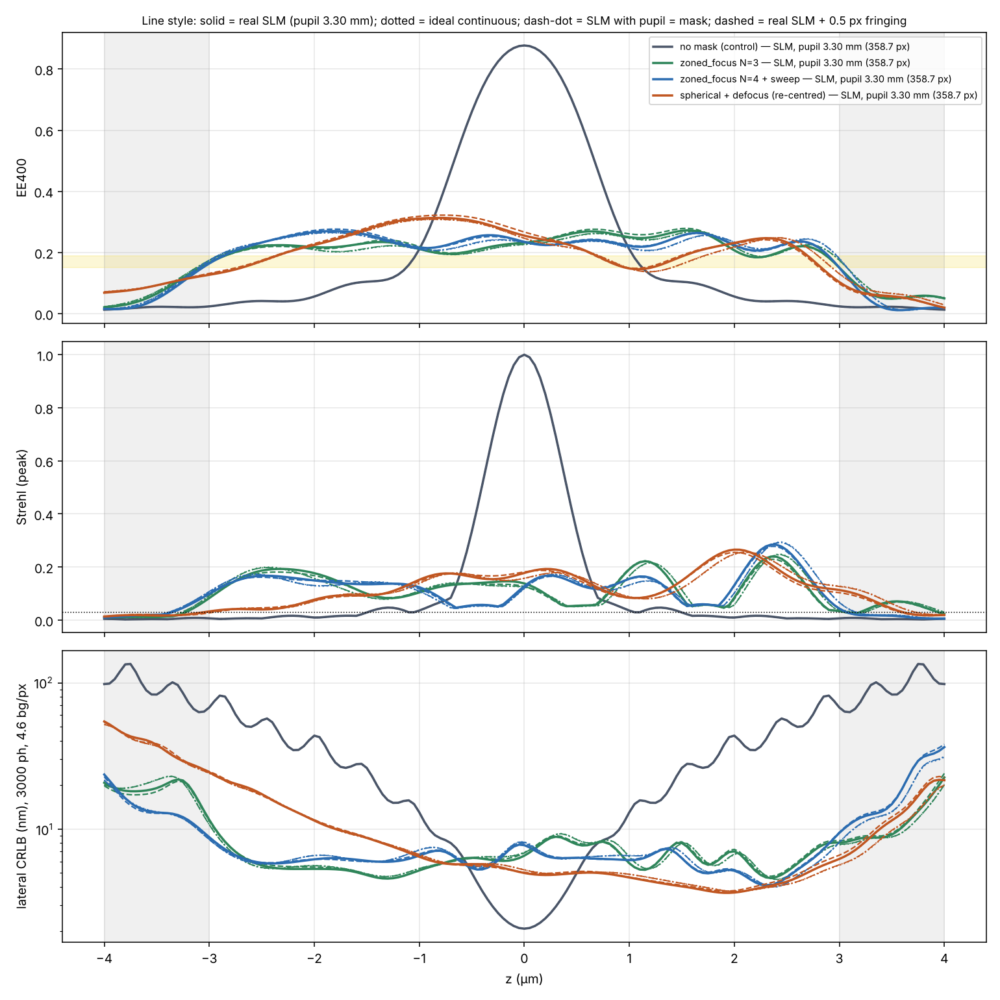
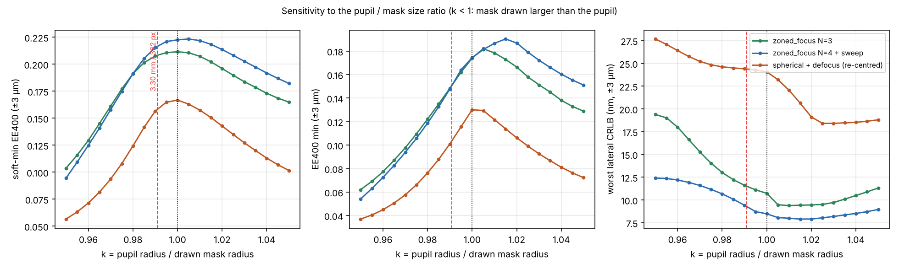
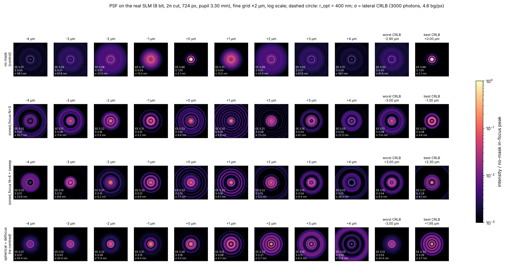
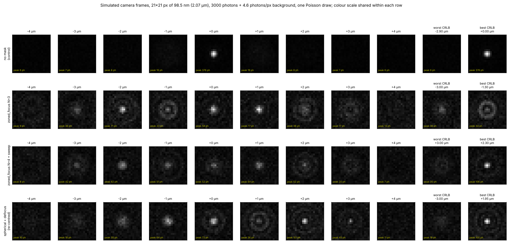
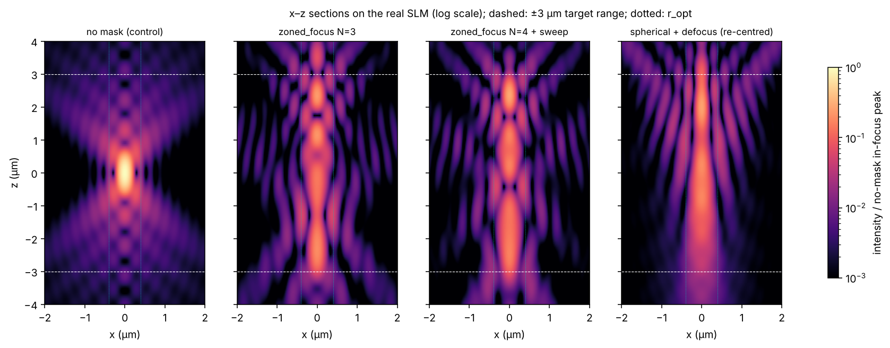
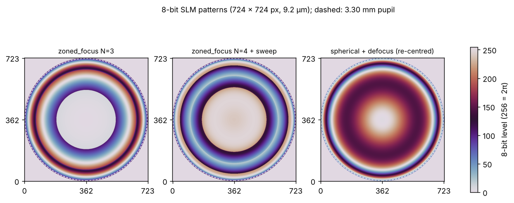

# Phase 4a: candidate masks on the real SLM

**The SLM as modelled.**
- 9.2 µm pixels; the mask is drawn 362 px in radius (724 × 724 px).
- 8-bit levels, phase range 0–2π, so every mask is Fresnel-cut (taken mod 2π) before display.
- The back-focal-plane pupil is 3.30 mm in radius, i.e. 3300 / 9.2 = **358.7 px**, so the drawn mask is about 0.9% larger than the pupil.
- The camera has 98.5 nm pixels and the photometry is the same as in Phase 2: 3,000 photons, 4.6 photons/px background, with a high-background case of 50 photons/px.

**Masks compared.**
- no mask (the control);
- the best zoned_focus N = 3;
- the best zoned_focus N = 4 + sweep;
- the best re-centred spherical (spherical + defocus).

All mask parameters come from `phase2/results.json`.

**Reproduce:**
- `python scripts/phase4a_slm_compare.py` (about 12 min);
- `python scripts/phase4a_pupil_scale.py` (about 3 min).

## The model (`psfsim/slm_psf.py`)

- **How the SLM is drawn.** The mask phase is evaluated at each SLM pixel centre in mask coordinates (ρ = r / 362 px). It is then cut to [0, 2π) and rounded to 256 levels. Optionally it is blurred by pixel crosstalk ("fringing", a Gaussian of σ in pixels). Each pixel is resolved by 3 × 3 sub-samples.
- **How the light is computed.** The true 3.30 mm pupil sets the NA, the apodization and the defocus. The field is computed with a matrix Fourier transform onto two image grids: a 25 nm grid over ±2.5 µm for the PSF, Strehl, EE400 and CRLB, and a 100 nm grid over ±10.5 µm for the EE denominator and EE50.
- **CRLB.** Computed from the analytic x-derivative of the field, binned into camera pixels.
- **Validation.** In "ideal" mode (continuous phase) the model reproduces the radial model of Phases 0–2 to within 0.5% for Strehl, EE400, EE50 and PW-M2, and to within 1% for the CRLB, at all tested depths. With no quantisation and no fringing, the 2π cut alone changes EE by less than 1e-4. Both checks are tests in `tests/test_slm_psf.py`.

**Configurations compared:**
- **ideal (continuous):** reproduces the Phase 2 numbers;
- **SLM, pupil = mask (362 px):** pixelation, 2π cut and 8 bits;
- **SLM, pupil 3.30 mm (358.7 px):** the above plus the measured pupil size. This is the headline "real SLM" case;
- **SLM, pupil 3.30 mm + fringing 0.5 px:** the above plus assumed crosstalk.

## 1. Does the real SLM change the theoretical performance?

Metrics over |z| ≤ 3 µm (z grid 50 nm):

| mask | configuration | soft-min EE400 | EE400 min | Strehl min | worst CRLB | worst CRLB, high bg | EE50 max ±2 µm |
|---|---|---|---|---|---|---|---|
| no mask | ideal | 0.035 | 0.024 | 0.005 | 81.7 nm | 206 nm | 1406 |
| no mask | real SLM | 0.035 | 0.024 | 0.005 | 81.8 nm | 206 nm | 1406 |
| zoned_focus N = 3 | ideal | 0.211 | 0.174 | 0.038 | 10.8 nm | 20.0 nm | 1682 |
| zoned_focus N = 3 | SLM, pupil = mask | 0.211 | 0.174 | 0.038 | 10.7 nm | 19.8 nm | 1682 |
| zoned_focus N = 3 | **real SLM** | **0.208** | **0.151** | 0.034 | **11.6 nm** | 22.0 nm | 1655 |
| zoned_focus N = 3 | real SLM + fringing | 0.208 | 0.150 | 0.033 | 11.3 nm | 21.6 nm | 1688 |
| zoned_focus N = 4 + sweep | ideal | 0.222 | 0.174 | 0.044 | 8.5 nm | 16.5 nm | 1455 |
| zoned_focus N = 4 + sweep | SLM, pupil = mask | 0.222 | 0.175 | 0.044 | 8.5 nm | 16.6 nm | 1456 |
| zoned_focus N = 4 + sweep | **real SLM** | **0.216** | **0.150** | 0.043 | **9.4 nm** | 20.2 nm | 1443 |
| zoned_focus N = 4 + sweep | real SLM + fringing | 0.217 | 0.150 | 0.043 | 9.5 nm | 20.4 nm | 1444 |
| spherical + defocus | ideal | 0.167 | 0.130 | 0.030 | 24.1 nm | 52.5 nm | 2311 |
| spherical + defocus | SLM, pupil = mask | 0.166 | 0.130 | 0.030 | 24.0 nm | 52.4 nm | 2310 |
| spherical + defocus | **real SLM** | **0.158** | **0.103** | 0.033 | **24.4 nm** | 52.5 nm | 2236 |
| spherical + defocus | real SLM + fringing | 0.154 | 0.098 | 0.027 | 24.8 nm | 54.7 nm | 2241 |

**Pixels, the 2π cut and 8 bits cost essentially nothing (< 0.5% on every metric).** With 724 px across the pupil:
- **Phase slope:** the steepest slope of any candidate is about 0.04 waves per pixel, more than ten times below the sampling limit of 0.5.
- **Quantisation:** the 8-bit step is 1/256 wave, about 0.001 waves RMS. That is a Strehl loss near 5e-5.
- **The cut:** cutting to 2π is exact, because exp(iφ) is periodic.

**The size mismatch is what matters.** The mask is drawn at 362 px but the pupil is 358.7 px:
- The light at pupil radius ρ sees the mask at 0.991 ρ, so every zone edge and focus shifts slightly.
- That cuts the EE floor by 14% for both zoned masks (0.174 → 0.150) and by 21% for the spherical mask, and worsens the worst-case CRLB by 8–10% for the zoned masks.
- The soft-min falls only 1.6–2.8% (5.3% for the spherical). The loss sits at the ±3 µm edges of the range, where EE falls steeply: the usable range shrinks slightly.
- The radial model with the mask rescaled by 0.991 reproduces these numbers exactly, so this is purely a scaling effect, not a pixel effect.

**Fringing (0.5 px, assumed) adds about 1% at most for the zoned masks.** The spherical mask is hurt more: its Strehl floor drops from 0.033 to 0.027, below the 0.03 limit. If your SLM's fringing is wider than this, it is worth measuring. The full sensitivity analysis is planned for Phase 4.

**The ranking does not change.** Under every SLM configuration and both background levels, zoned N = 4 + sweep > zoned N = 3 > re-centred spherical ≫ no mask, on the EE floor and on the worst-case CRLB. Both zoned masks stay inside the agreed 0.15–0.19 EE floor band, just barely, because of the size mismatch.

## 2. Fixing the mismatch: draw the mask on the true pupil radius

Here k = pupil radius / drawn mask radius (radial model, reference resolution):

- **k = 1 restores the design performance.** For example, zoned N = 4 + sweep returns to a soft-min of 0.223 and an EE floor of 0.174. So **draw the mask with ρ = 1 at the measured pupil radius, ≈ 358–359 px, not 362 px.**
- **The tolerance is one-sided.** Drawing the mask too large (k < 1) hurts quickly: about 2 px too large already costs about 5% of the EE floor. Drawing it slightly too small (k ≈ 1.00–1.01, i.e. 355–359 px) costs nothing. For the 4-zone mask it even raises the EE floor (up to 0.19 at k ≈ 1.015).
- **What to do in the lab:** measure the pupil radius on the SLM to about ±2 px (≈ 20 µm), and if in doubt draw the mask 1–3 px inside it.

## 3. What the PSFs look like (real SLM, pupil 3.30 mm)

Key depths. Each cell is EE400 / peak Strehl / lateral CRLB (nm) / EE50 (nm). The last two columns are the depths within ±3 µm with the worst and best CRLB.

| mask | −4 µm | −3 µm | −2 µm | −1 µm | 0 | +1 µm | +2 µm | +3 µm | +4 µm | worst CRLB | best CRLB |
|---|---|---|---|---|---|---|---|---|---|---|---|
| no mask | 0.013 / 0.005 / 98 / 2907 | 0.024 / 0.007 / 68 / 2178 | 0.056 / 0.010 / 44 / 1406 | 0.211 / 0.036 / 13 / 636 | 0.877 / 1.000 / 2.1 / 127 | 0.211 / 0.036 / 13 / 636 | 0.056 / 0.010 / 44 / 1406 | 0.024 / 0.007 / 68 / 2178 | 0.013 / 0.005 / 98 / 2907 | 82 nm @ −2.90 | 2.1 nm @ 0 |
| zoned N = 3 | 0.021 / 0.011 / 21 / 2001 | 0.166 / 0.083 / 11.6 / 1423 | 0.218 / 0.177 / 5.3 / 878 | 0.212 / 0.104 / 5.2 / 868 | 0.232 / 0.138 / 6.6 / 1366 | 0.250 / 0.192 / 5.8 / 1653 | 0.207 / 0.085 / 7.0 / 1625 | 0.151 / 0.034 / 8.1 / 2175 | 0.050 / 0.023 / 22 / 2828 | 11.6 nm @ −3.00 | 4.6 nm @ −1.30 |
| zoned N = 4 + sweep | 0.016 / 0.009 / 24 / 3062 | 0.164 / 0.099 / 8.8 / 2129 | 0.267 / 0.149 / 6.2 / 1443 | 0.215 / 0.124 / 6.6 / 1104 | 0.235 / 0.128 / 7.7 / 1387 | 0.221 / 0.156 / 6.1 / 1309 | 0.224 / 0.132 / 5.2 / 951 | 0.150 / 0.043 / 9.4 / 1467 | 0.019 / 0.006 / 36 / 2555 | 9.4 nm @ +3.00 | 4.1 nm @ +2.30 |
| spherical + defocus | 0.069 / 0.014 / 54 / 3700 | 0.127 / 0.033 / 24 / 2997 | 0.225 / 0.077 / 11.4 / 2236 | 0.311 / 0.152 / 6.4 / 1485 | 0.255 / 0.178 / 5.0 / 884 | 0.148 / 0.084 / 4.7 / 795 | 0.232 / 0.266 / 3.7 / 888 | 0.103 / 0.113 / 6.2 / 1241 | 0.020 / 0.019 / 22 / 1874 | 24 nm @ −3.00 | 3.7 nm @ +1.95 |

What the figures show:

- **No mask (control).** A diffraction-limited spot only within about ±0.7 µm: EE400 is 0.88 at focus and 0.21 at ±1 µm. Beyond ±2 µm the light spreads into a defocus disk of 1.4–2.9 µm EE50 radius, with peak pixels of 6–8 photons on a 4.6-photon background, so the emitter is effectively undetectable. The CRLB rises from 2 nm to 44–98 nm.
- **Zoned masks.** At every depth within ±3 µm there is a compact core inside the 400 nm circle carrying 15–27% of the light, plus a set of weak concentric rings (the interference between the zone foci).
  - The core gives a 36–77-photon peak pixel for N = 3, and 20–106 photons for N = 4 + sweep, against a background of 4.6. Their worst-case CRLBs (11.6 and 9.4 nm) are 7–9× better than the no-mask worst case.
  - Both have a dark ring around the core at some depths (e.g. N = 3 at −1.3 µm, N = 4 at +2 µm). It doesn't hurt the CRLB (these are their best depths), but it could bias a single-Gaussian fit. That is a point for Phase 5, where the fits are tested.
- **Re-centred spherical.**
  - Good from −1 to +3 µm, with the best CRLB anywhere (3.7 nm at +2 µm) and a bright, compact core on the +z side.
  - On the −z side it becomes a broad, dim blob: EE400 is 0.13 and the CRLB 24 nm at −3 µm. Its worst-case CRLB is 2.6× worse than the 4-zone mask.
  - It keeps some light at −4 µm (EE 0.07), but that doesn't make it usable there (CRLB 54 nm).
- **At ±4 µm all masks have collapsed** (EE400 ≤ 0.07, CRLB 21–98 nm). The zoned masks were designed for ±3 µm and fall off sharply just beyond it. Extending to ±4 µm would need a re-optimisation with a lower EE target: the flat ceiling over ±4 µm is 0.21.

## 4. SLM patterns

Each pattern is saved as an 8-bit grayscale PNG and a `.npy` array. Gray level = phase × 256 / 2π, mod 256, and the optical axis is on the corner of the four central pixels. Two sets are provided:

- `phase4a/slm_patterns/*.png`: drawn at 362 px, as analysed above;
- **`phase4a/slm_patterns/r358.7/*.png`: drawn at the 3.30 mm pupil radius (358.7 px), in the same 724 × 724 frame. These are the recommended ones (Section 2).**

To regenerate them for any measured radius, run `python scripts/export_slm_patterns.py --radius <px> --frame <even size>`.

Lab caveats:
- **Embedding.** These are only the mask disk. Placing it in the full SLM frame, the LUT and gamma calibration, and any carrier grating are up to your display pipeline.
- **Sign of z.** The z sign convention follows psfsim: positive z adds +(z/λ)·n·(cos θ − 1) waves of phase. If your SLM's phase response or the imaging optics invert the mask, the depth profile mirrors in z. For the asymmetric spherical mask that is clearly visible. A bead z-stack on the first day will settle it.

## Recommendation

- **Bench order.** Both zoned masks survive the real SLM. Carry **zoned_focus N = 4 + sweep** and **zoned_focus N = 3** to the bench, with the **re-centred spherical** and **no mask** as references.
- **Before imaging, draw every mask at the measured pupil radius** (~358–359 px, or 1–3 px inside it). This is the only SLM-related correction with a measurable effect, worth +15–16% on the EE floor of the zoned masks.
- **Still to model in Phase 4:** pupil decentration on the SLM per polarisation channel, the emission spectrum, depth-induced spherical aberration, and a measured fringing width.
