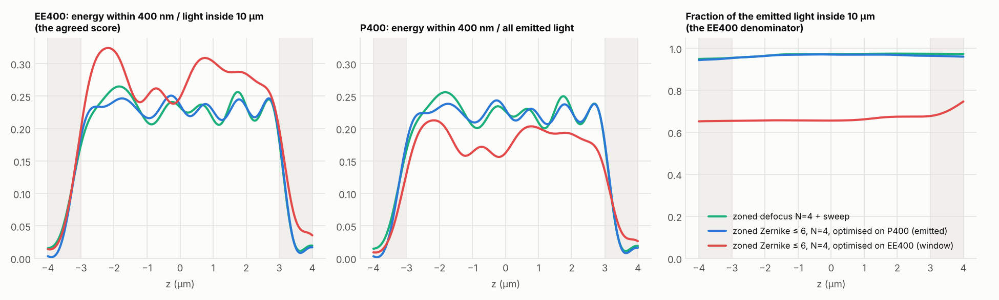
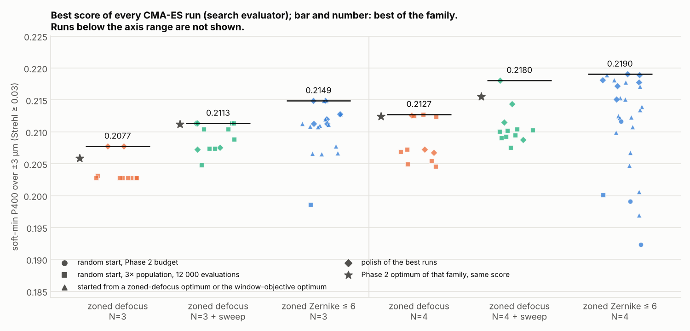
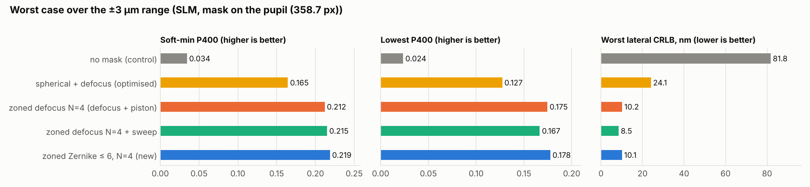
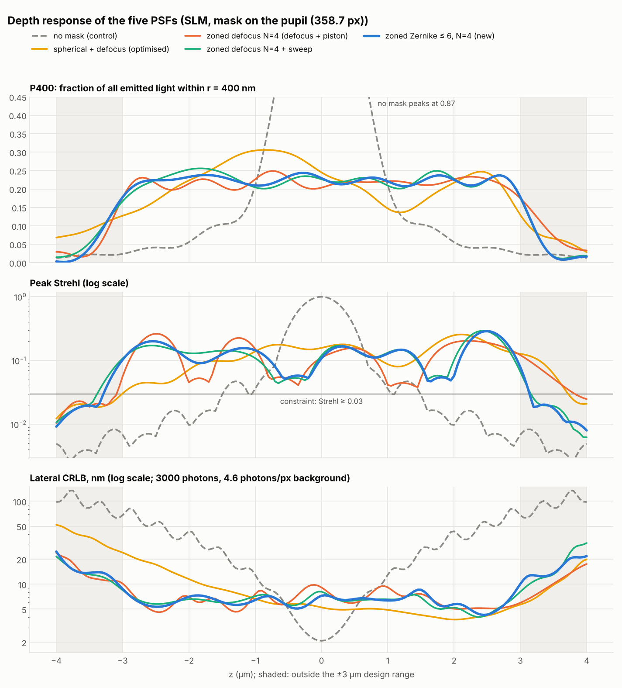
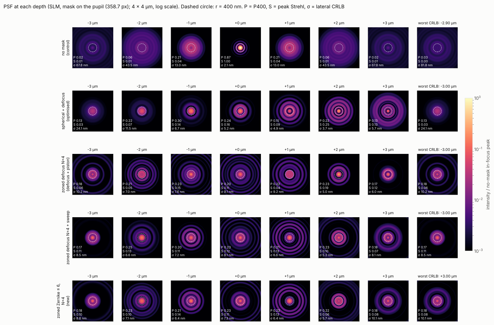
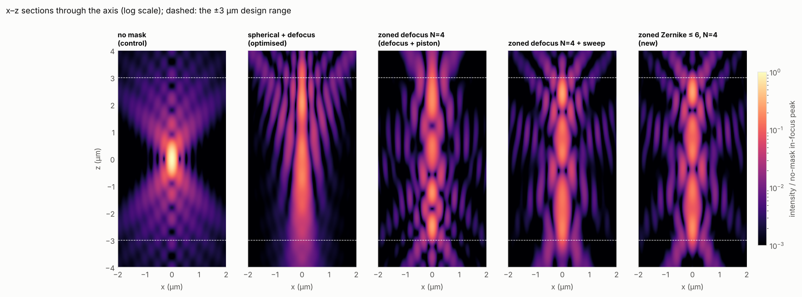
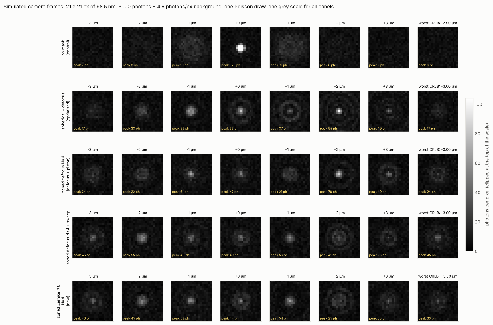
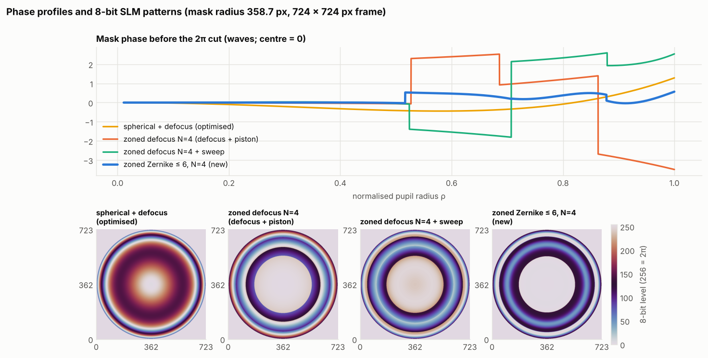

# Zoned masks with free Zernikes up to order 6 per zone

**Question.** Would a zoned radial mask whose zones each carry free Zernikes up to
order 6 (piston, defocus, primary and secondary spherical) beat the current zoned
masks, which carry only defocus and piston?

**Answer.** Not in a way that matters.

- Scored fairly, the best new mask (N = 4) is **0.5% better than zoned defocus
  N = 4 + sweep and 3% better than zoned defocus N = 4 (defocus + piston)**, when
  all three get the same search effort. Its worst-case CRLB is no better (10.0 nm
  against 8.3–8.9 nm).
- Scored with EE400 as agreed, it appears to win by 15% (0.259 against 0.227).
  **That gain is an artefact**: the optimiser defocuses the outer zones so far
  that a third of the light leaves the 10 µm window EE400 is normalised to. The
  core gets dimmer and the worst-case CRLB doubles to 19 nm.
- All N = 4 zoned masks, old and new, now sit within 2% of the ceiling set by how
  much of the depth budget they keep inside ±3 µm (η ≈ 0.80). More polynomial
  freedom per zone cannot move that ceiling.

**Recommendation.** Keep zoned defocus N = 4 + sweep and N = 3 as the bench
candidates. Score future searches on energy as a fraction of all emitted light
(`Targets(ee_denominator="emitted")`), so the loophole stays closed.

**Reproduce:**
- `python scripts/zz6_search.py --denominator window` (52 min, 4 cores, 1.14 M evaluations);
- `python scripts/zz6_search.py --denominator emitted` (49 min, 1.07 M evaluations);
- `python scripts/zz6_compare.py` (5 min).

Outputs are in `zoned_zernike6/`: one folder per objective (`window/`, `emitted/`)
with `results.json`, the search log and the best curves; `compare.json`;
`figures/`; and the SLM pattern of the new mask in `slm_patterns/`.

## The new family (`psfsim.families.ZonedZernikeRadial`)

- **Zones:** N zones with free edges, parameterised as in Phase 2.
- **Phase per zone:** Z(0,0), Z(2,0), Z(4,0) and Z(6,0), written in the zone's own
  unit-disk coordinate (the lab `zoned_zernike` mask with `local_coords=True`).
  A coefficient is the peak amplitude of that term inside the zone, in waves.
- **Bounds:** defocus ±2, primary spherical ±1, secondary spherical ±0.5 waves.
- **Size:** 14 parameters for N = 3 and 19 for N = 4.
- **It contains the current masks.** A zone of Zernikes up to order 6 is any cubic
  in ρ². The Phase 2 zoned-defocus optima, with or without sweep, are reproduced
  to within 1.5e-3 waves and to the fourth decimal of the score
  (`tests/test_zoned_zernike_radial.py`). So the new family can only tie or win,
  if the optimiser finds the optimum.

The terms line up with the existing masks: order 2 is defocus + piston, order 4
adds what the sweep term does, and order 6 adds one more degree of freedom per zone.

## 1. With EE400 as agreed, the optimiser finds a loophole

EE400 is the energy inside 400 nm divided by the energy inside 10 µm. A zone
defocused by more than about 7 µm spreads its light beyond 10 µm, so it drops out
of the denominator. The Phase 2 masks could not do this, because their zone depths
were bounded at ±4 µm. Free Zernike coefficients can, and CMA-ES found it.

Best masks under the agreed objective (soft-min EE400, Strehl ≥ 0.03; reference
evaluator):

| mask | soft-min EE400 (agreed score) | soft-min P400 (of all emitted light) | light inside 10 µm, min | worst CRLB, nominal / high bg |
|---|---|---|---|---|
| zoned Zernike ≤ 6, N = 4 | **0.259** | 0.172 | 0.65 | 18.7 / 37.9 nm |
| zoned Zernike ≤ 6, N = 3 | 0.243 | 0.189 | 0.77 | 13.9 / 27.0 nm |
| zoned defocus N = 4 + sweep | 0.227 | **0.218** | 0.95 | 9.0 / 17.9 nm |
| zoned defocus N = 4 | 0.219 | 0.213 | 0.97 | 10.0 / 20.6 nm |

- The N = 4 winner puts its third zone at the +2 wave defocus bound, a focus about
  16 µm away. 35% of the light lands outside 10 µm.
- Its EE400 rises 15% while the energy actually inside 400 nm falls 21%.
- The CRLB, which counts photons and does not use the window, shows the loss
  directly: 18.7 nm against 9.0 nm.
- The 2D matrix-Fourier model agrees with the radial model: 0.66 of the light
  inside 10 µm at z = 0.

On paper 0.259 clears the Phase 3 gate (0.245). It should not count: the gate was
written for a score that could not be inflated this way.

## 2. The fix: normalise to all emitted light

`Targets(ee_denominator="emitted")` scores **P400**, the energy inside 400 nm as a
fraction of all the light through the pupil. Everything else is unchanged: soft-min
over ±3 µm, Strehl ≥ 0.03. For masks that keep their light, P400 is 1–4% below
EE400 and ranks them almost identically. Both are now always reported, together with the
fraction of light inside 10 µm.

The second search uses this score for the new family and, with the same effort,
for the zoned-defocus masks.

## 3. Results with the corrected score

Reference evaluator (2048 rings, dz 12.5 nm). "Matched effort" means re-optimised
in this study with the same protocol as the new family.

| mask | params | soft-min P400 | P400 min | soft-min EE400 | light inside 10 µm, min | Strehl min | worst CRLB, nominal / high bg | EE50 max ±2 µm |
|---|---|---|---|---|---|---|---|---|
| **zoned Zernike ≤ 6, N = 4** | 19 | **0.2192** | 0.178 | 0.227 | 0.95 | 0.044 | 10.0 / 19.5 nm | 1538 |
| zoned defocus N = 4 + sweep, matched effort | 15 | 0.2182 | 0.175 | 0.226 | 0.95 | 0.046 | 8.9 / 17.8 nm | 1469 |
| zoned defocus N = 4 + sweep, Phase 2 | 15 | 0.2156 | 0.166 | 0.223 | 0.95 | 0.042 | 8.5 / 16.3 nm | 1456 |
| **zoned Zernike ≤ 6, N = 3** | 14 | **0.2150** | 0.175 | 0.217 | 0.99 | 0.045 | 10.6 / 20.7 nm | 1698 |
| zoned defocus N = 4, matched effort | 11 | 0.2129 | 0.169 | 0.219 | 0.97 | 0.044 | 8.3 / 16.7 nm | 1592 |
| zoned defocus N = 4, Phase 2 | 11 | 0.2124 | 0.175 | 0.219 | 0.97 | 0.038 | 10.1 / 20.6 nm | 1722 |
| zoned defocus N = 3 + sweep, matched effort | 11 | 0.2115 | 0.169 | 0.218 | 0.96 | 0.045 | 11.6 / 21.8 nm | 1660 |
| zoned defocus N = 3, matched effort | 8 | 0.2078 | 0.172 | 0.211 | 0.98 | 0.039 | 10.2 / 21.8 nm | 1890 |
| spherical + defocus (optimised) | 2 | 0.1650 | 0.127 | 0.167 | 0.98 | 0.030 | 24.1 / 52.5 nm | 2311 |
| no mask | 0 | 0.0346 | 0.024 | 0.035 | 0.99 | 0.005 | 82.7 / 208 nm | 1405 |

- **N = 4:** the new mask scores 0.2192. That is +0.5% over zoned defocus + sweep
  and +3.0% over defocus + piston at matched effort, and +1.7% / +3.2% over the
  Phase 2 versions of those masks.
- **N = 3:** the new mask scores 0.2150: +1.7% over zoned defocus + sweep and
  +3.5% over defocus + piston.
- **The CRLB does not improve.** The new N = 4 mask has a worst case of 10.0 nm
  against 8.3–8.9 nm for the zoned-defocus N = 4 masks. The mean CRLB over the
  range is 6.2–6.3 nm for all of them.
- **The best new mask is N = 4**, so that is the one compared in Section 4. It is a
  refinement of the zoned-defocus N = 4 + sweep solution, with nearly the same edges
  (ρ = 0.517, 0.708, 0.878 against 0.524, 0.707, 0.879) and small coefficients:
  no coefficient is near a bound.

**What each order buys** (best order-6 mask truncated and re-polished):

| terms per zone | N = 3 | N = 4 | equivalent existing mask |
|---|---|---|---|
| order 2: piston + defocus | 0.2072 | 0.2125 | zoned defocus (0.2078 / 0.2129) |
| order 4: + primary spherical | 0.2108 | 0.2183 | zoned defocus + sweep (0.2115 / 0.2182) |
| order 6: + secondary spherical | 0.2150 | 0.2192 | – |

Primary spherical per zone does the same job as the sweep term. Secondary
spherical adds 0.4% at N = 4 and 2% at N = 3.

**Why there is nothing left to gain.** The soft-min cannot exceed the mean of
P400 over the range, and the mean is η × 0.280, where η is the share of the
mask-independent depth budget that falls inside ±3 µm. The best N = 4 zoned masks all
have η = 0.80, so their mean is 0.223–0.224. The new mask's soft-min is 98.2% of its
mean: the ripple is nearly gone. Higher orders smooth the profile but do not
raise η.

### Search reliability

- **Random starts do poorly in the new family.** Of 32 random starts per N, the
  best reached 0.199 (N = 3) and 0.212 (N = 4), and the median was 0.17–0.18. The
  winning masks all descend from runs started at a zoned-defocus optimum.
- **So a better, unrelated optimum cannot be ruled out.** The ceiling argument
  above bounds what it could be worth: about 2% unless it also raises η.
- **The comparison is matched.** The zoned-defocus masks were re-optimised under
  the same score with long random restarts and polishing of every Phase 2 run.
  That raised N = 4 + sweep from 0.2156 to 0.2182. Two of its sweeps are at the
  ±4 µm bound.

## 4. PSF comparison

Five PSFs: no mask, the optimised spherical mask (spherical + defocus), zoned
defocus N = 4 (defocus + piston), zoned defocus N = 4 + sweep, and the new zoned
Zernike N = 4. The zoned-defocus masks are the Phase 2 ones, i.e. the current
candidates.

All figures use the pixel-level SLM model of Phase 4a (9.2 µm pixels, 8 bit, 2π
cut), with the mask drawn at the measured pupil radius of 358.7 px, as Phase 4a
recommends. Photometry: 3000 photons, 4.6 photons/px background.

Each cell is P400 / peak Strehl / lateral CRLB (nm) / EE50 (nm):

| mask | −3 µm | −2 µm | −1 µm | 0 | +1 µm | +2 µm | +3 µm |
|---|---|---|---|---|---|---|---|
| no mask | 0.024 / 0.007 / 68 / 2178 | 0.056 / 0.010 / 44 / 1406 | 0.210 / 0.036 / 13.0 / 636 | 0.873 / 1.000 / 2.1 / 127 | 0.210 / 0.036 / 13.0 / 636 | 0.056 / 0.010 / 44 / 1406 | 0.024 / 0.007 / 68 / 2178 |
| spherical + defocus | 0.127 / 0.030 / 24.1 / 3053 | 0.223 / 0.072 / 11.5 / 2310 | 0.304 / 0.139 / 6.7 / 1546 | 0.245 / 0.158 / 5.2 / 929 | 0.147 / 0.087 / 4.9 / 816 | 0.217 / 0.249 / 3.7 / 910 | 0.129 / 0.127 / 5.7 / 1186 |
| zoned defocus N = 4 | 0.176 / 0.056 / 10.2 / 2039 | 0.214 / 0.045 / 7.0 / 1359 | 0.226 / 0.152 / 7.6 / 1465 | 0.203 / 0.111 / 9.1 / 1635 | 0.221 / 0.041 / 9.2 / 1327 | 0.226 / 0.193 / 5.0 / 1107 | 0.175 / 0.121 / 6.0 / 1680 |
| zoned defocus N = 4 + sweep | 0.167 / 0.108 / 8.5 / 2131 | 0.253 / 0.130 / 6.6 / 1456 | 0.204 / 0.109 / 7.2 / 1157 | 0.226 / 0.120 / 8.1 / 1440 | 0.209 / 0.133 / 6.6 / 1326 | 0.227 / 0.102 / 5.2 / 980 | 0.175 / 0.066 / 8.1 / 1370 |
| zoned Zernike ≤ 6, N = 4 | 0.178 / 0.103 / 8.8 / 2080 | 0.233 / 0.104 / 7.1 / 1435 | 0.209 / 0.145 / 6.4 / 1145 | 0.229 / 0.108 / 7.3 / 1370 | 0.221 / 0.128 / 6.4 / 1323 | 0.225 / 0.057 / 5.7 / 1544 | 0.178 / 0.078 / 10.1 / 1860 |

What the figures show:

- **New mask against zoned defocus N = 4 + sweep.** The two PSFs are nearly the
  same at every depth: same core, same ring pattern, the same three bright lobes
  along z. The new mask has a flatter P400 profile (0.18–0.24 against
  0.17–0.26), which is where its score comes from. It is slightly better around
  the centre (CRLB 6.4–7.3 nm against 6.6–8.1 nm from −1 to +1 µm) and worse at
  +2 to +3 µm, where its Strehl drops to 0.06–0.08 and the CRLB reaches 10.1 nm
  against 8.1 nm.
- **New mask against zoned defocus N = 4 (defocus + piston).** The plain mask has
  deeper Strehl dips (0.04 at −2 and +1 µm) and
  a worse CRLB through the centre (9.1–9.2 nm at 0 and +1 µm). It holds up better
  at +3 µm (6.0 nm). Worst case over the range is the same: 10.2 against 10.1 nm.
- **Against the optimised spherical mask.** The spherical mask is the best of all
  from 0 to +3 µm (CRLB 3.7–5.7 nm) and far worse on the −z side: a broad, dim spot
  with 24 nm CRLB at −3 µm. All three zoned masks cut its worst case by 2.4–2.8×.
- **Against no mask.** Without a mask the emitter is only usable within about
  ±1 µm: 2.1 nm at focus, 13 nm at ±1 µm, 44–68 nm beyond ±2 µm. The zoned masks
  give up the in-focus peak (Strehl 0.11–0.12 at z = 0) for 4–10 nm across the
  whole ±3 µm.

### On the SLM

Soft-min P400 / lowest P400 / worst CRLB over ±3 µm:

| mask | ideal (continuous) | SLM, mask on the pupil | SLM, mask 362 px on a 358.7 px pupil | SLM, mask on the pupil + fringing 0.5 px |
|---|---|---|---|---|
| spherical + defocus | 0.165 / 0.127 / 24.1 nm | 0.165 / 0.127 / 24.1 nm | 0.156 / 0.103 / 24.4 nm | 0.162 / 0.120 / 23.2 nm |
| zoned defocus N = 4 | 0.212 / 0.175 / 10.2 nm | 0.212 / 0.175 / 10.2 nm | 0.209 / 0.152 / 11.2 nm | 0.206 / 0.164 / 10.7 nm |
| zoned defocus N = 4 + sweep | 0.215 / 0.166 / 8.5 nm | 0.215 / 0.167 / 8.5 nm | 0.209 / 0.146 / 9.4 nm | 0.214 / 0.169 / 8.3 nm |
| zoned Zernike ≤ 6, N = 4 | 0.219 / 0.178 / 10.0 nm | 0.219 / 0.178 / 10.1 nm | 0.214 / 0.149 / 12.4 nm | 0.212 / 0.164 / 11.2 nm |

- **Pixels, the 2π cut and 8 bits cost nothing** for the new mask either
  (< 0.5%).
- **The new mask is the most sensitive to the other two effects.** The 0.9% size
  mismatch raises its worst CRLB by 23% (11% for zoned defocus + sweep). Assumed
  fringing of 0.5 px takes 3% off its soft-min and adds 11% to its worst CRLB
  (−1% and −2% for zoned defocus + sweep). With fringing, its small score
  advantage is gone (0.212 against 0.214).
- **It is no harder to display.** Phase jumps of 0.44, 0.02 and 0.31 waves after
  the cut, a steepest slope of 0.030 waves per pixel and a narrowest zone of 44 px
  are all in the range of the existing zoned masks.

The 8-bit pattern of the new mask at 358.7 px is in
`zoned_zernike6/slm_patterns/` (724 × 724 px frame, PNG and NPY), should you want
to try it.

## What this changes

- **The candidate list stays as it is.** The new mask does not beat zoned defocus
  N = 4 + sweep on the CRLB, beats it by 0.5% on the score, has four more
  parameters and is more sensitive to pupil scale and fringing.
- **The score should change.** Any family that can defocus a zone by more than
  about 7 µm will exploit the EE400 window. The Phase 2 results are not affected
  (their masks keep 95–98% of the light inside 10 µm), but a Phase 3 search over a
  richer family would be.
- **The Phase 3 gate (0.245) is out of reach for radial zoned masks.** At η = 0.80
  a perfectly flat profile gives 0.224 in P400, and the best mask here is already
  at 0.219. Getting further needs a higher η, i.e. a sharper cut-off at ±3 µm, not
  more freedom per zone.
- **Not tested here:** N = 5 with free Zernikes, orders above 6, and the emission
  spectrum, pupil decentration and depth-induced spherical aberration that Phase 4
  still has to model.
